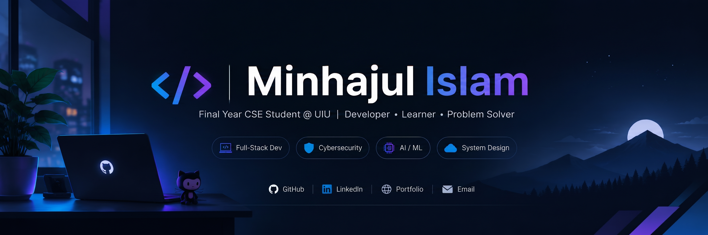
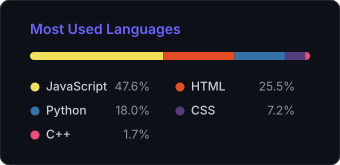

  

  

  <b>Final-year CSE Student @ UIU · Web Developer · Exploring Cybersecurity & AI</b>

  
  
  
  

---

### About Me

I'm a final-year Computer Science & Engineering student at **United International University (UIU)**, currently in my 10th trimester. I like building things, figuring out how they work, and finding ways to make them better.

Most of my work so far has been in web development — building full-stack applications with React, Next.js, and Node.js. But I'm also spending more time exploring other areas that interest me, especially cybersecurity and AI/ML, which I'm studying through my university courses.

I'm still figuring out where I want to specialize, and honestly, that's part of the fun.

- **Currently exploring:** Linux, Cybersecurity, AI, and Machine Learning
- **Working with:** React, Next.js, TypeScript, Node.js, and related tools
- **Learning:** Application security, networking fundamentals, Linux
- **Interested in:** Software quality, system design, security, and practical problem-solving

---

### Tech Stack

#### Frontend

  
  
  
  
  
  
  
  
  
  

#### Backend & Database

  
  
  
  
  
  
  

#### Programming Languages

  
  
  
  

#### Tools

  
  
  

---

### Highlighted Projects

| Project | Description | Live |
| :--- | :--- | :---: |
| **ParkEase-BD** | A team-built, location-based parking marketplace for Dhaka. Drivers discover spaces on an interactive map, make bookings, and get a QR/OTP access pass. Multiple role-specific workspaces: driver, owner, manager, guard, and admin. I contributed as **frontend engineer** — UI flows, component systems, and backend API integration. | [Source](https://github.com/Minhajh2o/ParkEase-BD) · [Live Demo](https://parkease-bd.vercel.app/)  |
| **UIU English Language Forum** | Official platform for UIUELF — event listings with individual event pages, event registration, photo gallery, member join form, and an admin dashboard for content management. Built with React, Tailwind, Node.js, and MongoDB. | [Visit →](https://uiuelf.vercel.app) |
| **Sheeter Alo** | Winter donation platform connecting donors with volunteers for helping people in need. Built with React, Firebase, and Tailwind. | [Visit →](https://sheeter-alo.web.app) |
| **Tango-Time** | An interactive Japanese language learning app with vocabulary lessons and pronunciation guides. Built with React, DaisyUI, and Firebase. | [Visit →](https://tango-time-d7d0c.web.app) |
| **UIU CGPA Calculator** | A CGPA calculation tool designed specifically for UIU students and their grading system. | [Visit →](https://cgpa-calculator-uiu.vercel.app/) |

> Want to see more? Check out my [Portfolio](https://portfolio-minhajul-islam.vercel.app/).

---

### Certifications & Courses

| Credential | Issuer | Link |
| :--- | :--- | :---: |
| **Introduction to Cybersecurity** | Cisco | [View Credential](https://www.credly.com/badges/373611be-4c2d-420d-af07-ab361082a3dd/public_url) |
| **Cybersecurity Essentials** — Credential: *Junior Cybersecurity Analyst Career Path* | Cisco | [View Credential](https://www.credly.com/badges/e9f3a41c-3e4c-4076-96ff-b78d39dc8ce7/public_url) |

---

### GitHub Activity

  

 

  
  
  

---

  <i>Thanks for stopping by. Feel free to reach out — I'm always up for a conversation about code, projects, or anything interesting.</i>

<!---
Minhajh2o/Minhajh2o is a ✨ special ✨ repository because its `README.md` (this file) appears on your GitHub profile.
You can click the Preview link to take a look at your changes.
--->
